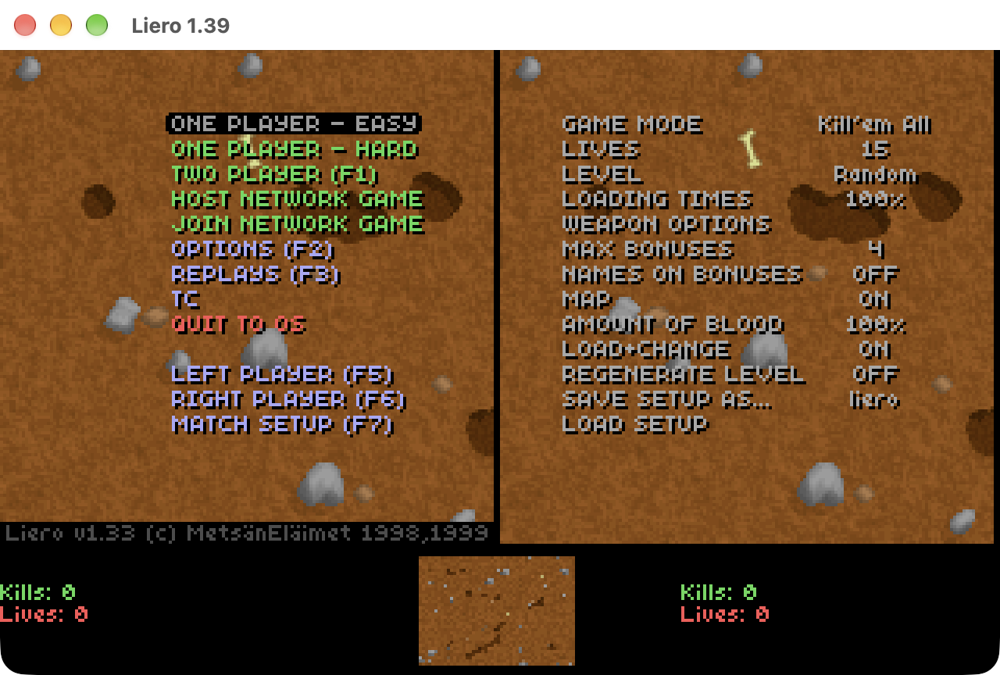
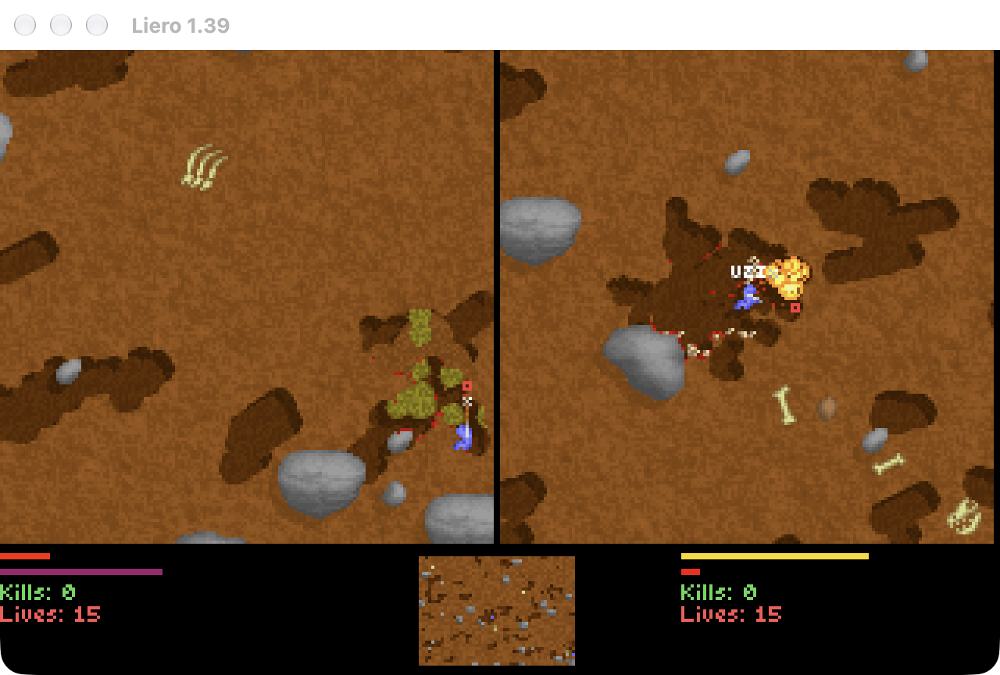
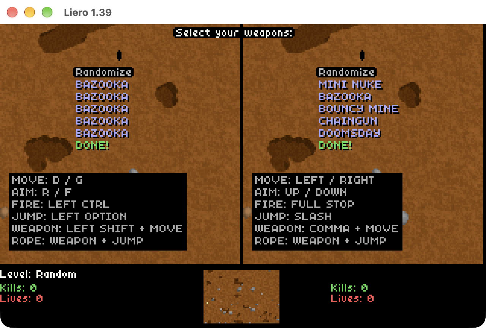
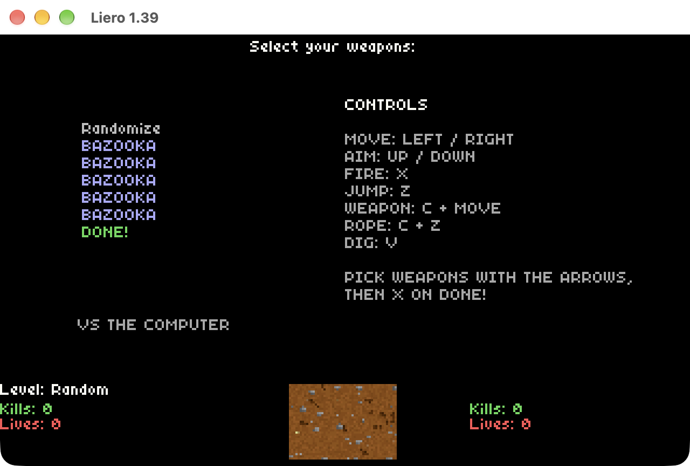

# OpenLiero for Mac: network play edition

This is a fork of **[OpenLiero](https://github.com/gliptic/liero)** by **[gliptic](https://github.com/gliptic)**
and its contributors, itself a faithful recreation of **Liero** with its source code published, the classic
1998 worm deathmatch game by **Joosa Riekkinen (MetsänEläimet)**. All credit for the game,
its engine and its design goes to them. This fork only adds the features listed below.



## What this fork adds

- **Network play over Wi-Fi:** one player picks *Host Network Game*, the other *Join Network Game*
  and the host is found automatically on the local network (or type the IP address shown on
  the host's screen). Both Macs run the same deterministic simulation and only exchange key
  presses (lockstep, with a 3-frame input delay and checksums to detect desyncs).
  The joiner is the left worm and the host the right worm.
- **One player vs the computer:** *Easy* uses the classic Liero CPU, *Hard* the predictive AI
  from OpenLiero. The computer picks its weapons out of sight.
- **Controls on screen:** the weapon selection screen lists each player's keys.
- **MacBook-friendly keys:** one player and network games use the arrow keys plus
  **X** fire, **Z** jump, **C** change weapon (**C + Z** ninja rope) and **V** dig.
  In local two player games the right player uses the arrows plus **.** fire, **,** change and **/** jump
  (MacBooks have no Right Ctrl key).
- **A self-contained Mac app:** `pkg/package_mac.sh` builds `Liero.app` with SDL bundled
  inside, plus a zip to share, and settings live in `~/Library/Application Support/OpenLiero`.
- Small fixes: absolute paths on macOS, Cmd+Q quits, and the game falls back to the bundled
  data when the original Liero data hasn't been converted.

| Network match | Two player weapon selection | One player weapon selection |
|---|---|---|
|  |  |  |

## Building the Mac app

```bash
brew install cmake sdl2 sdl2_image dylibbundler
pkg/package_mac.sh
```

This produces `dist/Liero.app` and `dist/Liero.zip`. The repository only contains OpenLiero's
free game data; to play with the original Liero data, convert it with `tctool` as described
below before packaging. Network players need the same version of the app and the same data.

The app is not signed with an Apple developer account, so the first time it is opened on another
Mac, right-click it and choose **Open** (or allow it under System Settings > Privacy & Security).

## Credits

- **Liero:** Joosa Riekkinen (MetsänEläimet), 1998-1999.
- **OpenLiero:** [gliptic](https://github.com/gliptic) with [Anders Höckersten](https://github.com/ahockersten),
  [George Rawlinson](https://github.com/grawlinson), [emillaine](https://github.com/emillaine),
  [milleniumbug](https://github.com/milleniumbug) and
  [the other contributors](https://github.com/gliptic/liero/graphs/contributors).
- **Replacement sound effects:** "sea", WTFPL (via lierolibre); see `TC/openliero/sounds/sounds.txt`.
- **Network play, one player mode and Mac packaging in this fork:** Huw Rowlands, built with Claude Code.

The upstream project does not specify a licence and this fork does not add one; the original
authors' rights apply.

---

# Original OpenLiero README


How to build (Windows)
======================

Building on Windows
-----------------------
* Install Visual Studio 2022
* Install SDL 2
  * Go to https://github.com/libsdl-org/SDL/releases
  * Download e.g. SDL2-devel-2.26.1-VC.zip
  * Extract the contents to somewhere on your file system
  * Set the SDL2_DIR environment variable to the directory you extracted the files to
* Install SDL2_image
  * Go to https://github.com/libsdl-org/SDL_image/releases
  * Download e.g. SDL2_image-devel-2.6.2-VC.zip
  * Extract the contents to somewhere on your file system
  * Set the SDL2_image_DIR environment variable to the directory you extracted the files to
* Copy everything from the pkg directory to the same folder as openliero.exe ends up in, e.g. `out\build\x64-Debug` or `out\build\x64-Release`
* Download SDL 2
  * Go to https://github.com/libsdl-org/SDL/releases
  * Download e.g. SDL2-2.26.1-win32-x64.zip
  * Put SDL2.dll either in your system32 folder or in the same folder as openliero.exe ends up in, e.g. `out\build\x64-Debug` or `out\build\x64-Release`
* Download SDL2_image
  * Go to https://github.com/libsdl-org/SDL_image/releases
  * Download e.g. SDL2_image-2.6.2-win32-x64.zip
  * Put SDL2_image.dll either in your system32 folder or in the same folder as openliero.exe ends up in, e.g. `out\build\x64-Debug` or `out\build\x64-Release`
* Copy everything from the pkg directory to the same folder as openliero.exe ends up in, e.g. `out\build\x64-Debug` or `out\build\x64-Release`


(Optional) Dependencies for building the video tool
-----------------------
* Follow the instructions for installing dependencies needed to build ffmpeg. At the time of writing, the MSYS2 route worked best for me https://trac.ffmpeg.org/wiki/CompilationGuide/MinGW
* Download latest libx264: git clone git://git.videolan.org/x264.git
* Build it: cd x264; ./configure --enable-shared --enable-pic && make -j8
* Download latest ffmpeg: git clone git://source.ffmpeg.org/ffmpeg.git ffmpeg
* Build it: cd ffmpeg; ./configure --enable-shared --enable-pic --enable-gpl --enable-libx264 --disable-programs --extra-ldflags=-L../x264 --extra-cflags=-I../x264 && make -j8

How to build (Linux and Mac)
============================

Building on Linux and Mac
-------------------------
* Make sure you have CMake, SDL2, SDL2_image and gcc installed
* Run cmake:
* $ cmake -G "Unix Makefiles"
* Run "make"
* Copy everything from the pkg directory to the root directory used for the build

(Optional) Enabling and building the video tool
-------------------------------
* Download latest libx264: git clone git://git.videolan.org/x264.git
* Build it: cd x264; ./configure --enable-shared --enable-pic && make -j8
* Download latest ffmpeg: git clone git://source.ffmpeg.org/ffmpeg.git ffmpeg
* Build it: cd ffmpeg; ./configure --enable-shared --enable-pic --enable-gpl --enable-libx264 --disable-programs --extra-ldflags=-L../x264 --extra-cflags=-I../x264 --extra-libs=-ldl && make -j8
* Run: make -j8 videotool

Building a release build
---------------------
* Run cmake:
* $ cmake -DCMAKE_BUILD_TYPE=Release -G "Unix Makefiles"
* Run "make"

Extracting game data for total conversions
======================

For copyright reasons, this repository does not contain the original Liero sound
files. Included instead is the original ruleset together with the lierolibre
sound effects.

In order to use the original data, or any total conversion, you need to run
the tctool on the game data. Example on how to do this is included below:

Windows
---------------------
```powershell
Invoke-WebRequest https://www.liero.be/download/liero-1.36-bundle.zip -OutFile liero-1.36-bundle.zip
Expand-Archive -LiteralPath .\liero-1.36-bundle.zip .
.\out/build/x64-Release/tctool.exe liero-1.36-bundle
Move-Item .\TC\liero-1.36-bundle .\TC\"Liero v1.33"
Remove-Item .\liero-1.36-bundle.zip
Remove-Item -Recurse .\liero-1.36-bundle
Copy-Item -Recurse .\TC .\out\build\x64-Debug
Copy-Item -Recurse .\TC .\out\build\x64-Release
```

Linux/Mac
---------------------
```bash
curl https://www.liero.be/download/liero-1.36-bundle.zip -O
unzip liero-1.36-bundle.zip
./tctool liero-1.36-bundle
mv TC/liero-1.36-bundle TC/"Liero v1.33"
rm liero-1.36-bundle.zip
rm -rf liero-1.36-bundle
```
